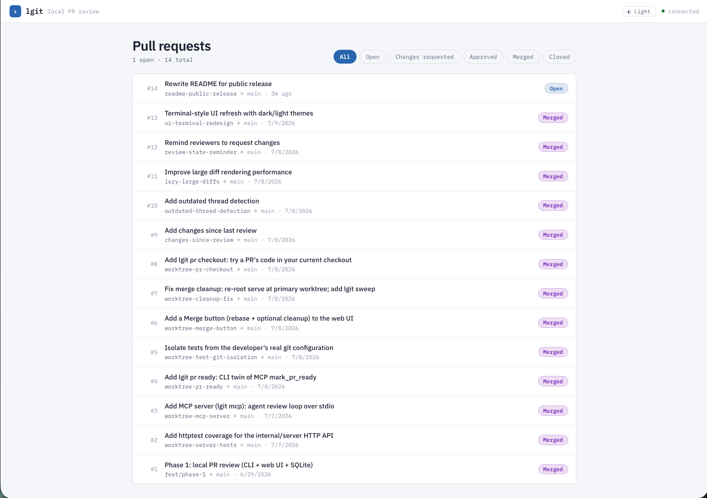
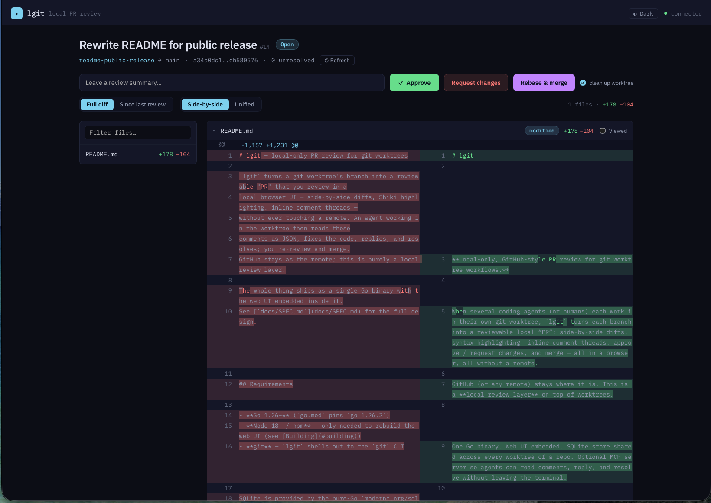
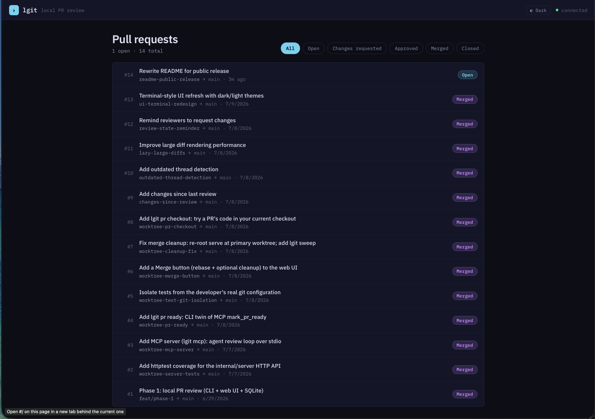
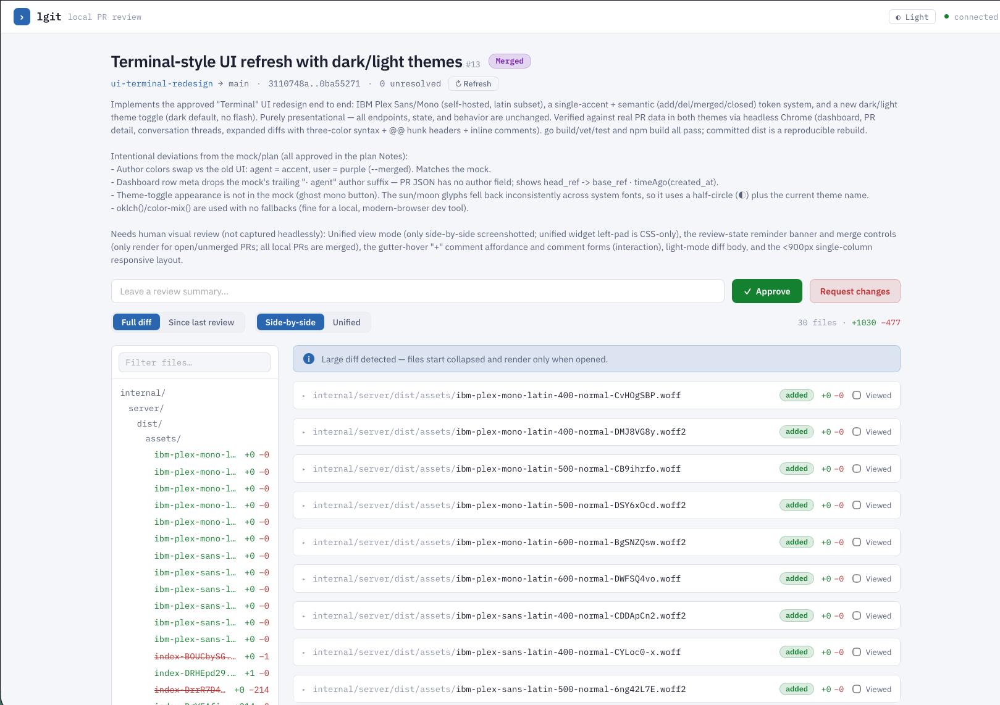

# lgit

**Local-only, GitHub-style PR review for git worktree workflows.**

When several coding agents (or humans) each work in their own git worktree, `lgit` turns each branch into a reviewable local “PR”: side-by-side diffs, syntax highlighting, inline comment threads, approve / request changes, and merge — all in a browser, all without a remote.

GitHub (or any remote) stays where it is. This is a **local review layer** on top of worktrees.

One Go binary. Web UI embedded. SQLite store shared across every worktree of a repo. Optional MCP server so agents can comment, reply, resolve, and submit review verdicts without leaving the terminal. Merge stays a human action.

## Screenshots

**Dashboard** — open PRs across worktrees, filter by state:



**PR review** — side-by-side diffs, file tree, approve / request changes / merge:



**Inline comments** — threads on any line; agents comment, reply, and resolve via CLI or MCP:



**Changes since last review** — re-review only what landed after your last verdict:



## Why

Closest tools ([diffx](https://github.com/wong2/diffx), [difit](https://github.com/yoshiko-pg/difit)) are excellent *diff viewers*, not *PR forges*: comments are ephemeral, there’s no multi-PR store, no merge, and worktrees aren’t first-class. Agent orchestrators usually push review through real GitHub PRs.

`lgit` is for the loop you actually want when agents work in parallel locally:

1. Agent finishes in a worktree → `lgit pr create`
2. You review in the browser, leave inline comments, request changes
3. Agent reads unresolved threads (CLI JSON or MCP), fixes, replies, resolves
4. You re-review (including “changes since last review”), approve
5. Merge (rebase by default) and optionally clean up the worktree + branch

## Features

- **Worktree-native PRs** — create a PR from inside a feature worktree; one SQLite DB at the shared git dir is visible from every worktree
- **Browser review UI** — side-by-side / unified diffs, Shiki highlighting, file tree, collapse unchanged, viewed checkboxes, inline threads, PR-level conversation
- **Review lifecycle** — open → changes requested / approved → merged / closed; “changes since last review”; outdated-thread badges
- **Merge** — default rebase (linear history); squash and merge-commit available on the CLI; optional worktree + branch cleanup
- **Agent contract** — `lgit pr comments --json`, comment / reply / resolve / review / ready; or MCP tools over stdio. Merging is always the human's call.
- **Single binary** — pure-Go SQLite (no cgo), UI embedded via `//go:embed`

## Install

### From source (recommended)

Requires **Go 1.26+** and **git**. Node is only needed if you rebuild the web UI.

```bash
git clone https://github.com/mattacton/lgit.git
cd lgit
go build -o lgit ./cmd/lgit
# optional: install onto your PATH
cp lgit "$(go env GOPATH)/bin/lgit"
```

The built frontend is already checked in under `internal/server/dist/`, so a plain `go build` produces a binary that serves the UI.

### Requirements

| Tool | Needed for |
|------|------------|
| Go 1.26+ | building the binary |
| git | all git operations (`lgit` shells out to the `git` CLI) |
| Node 18+ / npm | rebuilding the web UI only |

No system SQLite; storage uses pure-Go [`modernc.org/sqlite`](https://pkg.go.dev/modernc.org/sqlite).

## Quick start

```bash
# once per repo
lgit init

# from a feature worktree (branch already exists)
lgit pr create --title "Add rate limiting" --base main
lgit pr base <number> <branch>   # retarget if it should merge elsewhere

# review in the browser
lgit serve                    # http://127.0.0.1:7333
# optional: try the PR code in your current checkout (detached HEAD)
lgit pr checkout <number>     # return with: git switch main

# after feedback is addressed (agent or human)
lgit pr comments <number> --unresolved --json
lgit pr reply <thread-id> "Fixed in the last commit." --author agent
lgit pr resolve <thread-id>
lgit pr ready <number>        # changes_requested → open

# agents reviewing a PR (does not merge)
lgit pr comment <number> "overall note"
lgit pr comment <number> "why this?" --file src/foo.go --line 12
lgit pr review <number> --request-changes --body "needs tests"
lgit pr review <number> --approve

# integrate (human)
lgit merge <number> --cleanup # default: rebase; also --squash / --merge
lgit sweep                    # finish leftover cleanup for merged PRs
```

Run `lgit help` for the full command list.

## How storage works

Everything lives in one SQLite database:

```text
$(git rev-parse --git-common-dir)/lgit/lgit.db
```

All worktrees of a repo share `--git-common-dir`, so that single DB is visible from every checkout — no per-worktree config. `lgit init` creates the directory and schema (idempotent).

## The review loop

```text
 worktree branch ──► lgit pr create ──► lgit serve (browser)
                                              │
                     inline comments + request changes
                                              │
                     agent: comments --json / MCP
                     fix → reply → resolve → ready
                                              │
                     re-review → approve → merge --cleanup
```

**Human side:** open the dashboard, review the diff, comment on lines, request changes or approve, merge when ready.

**Agent side:** list open PRs, fetch unresolved threads as JSON (or via MCP), apply fixes, reply with what changed, resolve only threads actually addressed, then `lgit pr ready` so the PR is open for re-review again. Agents can also review other PRs (`lgit pr comment` / `lgit pr review`, or the MCP twins) and retarget one with `lgit pr base` / `set_pr_base` when it should merge into a different branch. Merging is always the human's call.

## CLI

| Command | Purpose |
|---------|---------|
| `lgit init` | Create DB + schema at the shared git dir |
| `lgit pr create [--title] [--base main]` | Open a PR from the current worktree |
| `lgit pr base <n> <branch>` | Change a PR's target branch |
| `lgit pr list [--state] [--json]` | List PRs |
| `lgit pr view <n>` | Show one PR |
| `lgit pr comments <n> [--unresolved] [--json]` | List threads (JSON = agent contract) |
| `lgit pr comment <n> <body> [--file F --line N]` | Start a thread (omit `--file` for PR-level) |
| `lgit pr reply <thread-id> <body> [--author agent]` | Reply on a thread |
| `lgit pr resolve <thread-id>` | Resolve a thread |
| `lgit pr review <n> --approve\|--request-changes [--body]` | Submit a review verdict (does not merge) |
| `lgit pr ready <n>` | Mark `changes_requested` ready for re-review |
| `lgit pr checkout <n>` | Detach HEAD at the PR tip to try the code |
| `lgit serve [--port 7333]` | Web UI + JSON API |
| `lgit mcp` | MCP tools over stdio |
| `lgit merge <n> [--rebase\|--squash\|--merge] [--cleanup]` | Integrate (default rebase) |
| `lgit sweep` | Remove leftover worktrees/branches of merged PRs |

## MCP server (agent integration)

`lgit mcp` exposes the agent side of the loop over stdio:

- `list_prs`
- `get_pr`
- `get_unresolved_comments`
- `create_comment`
- `reply_comment`
- `resolve_comment`
- `create_review`
- `mark_pr_ready`
- `set_pr_base`

There is no merge tool. Merging stays CLI/UI for humans.

### Claude Code (user-wide)

Register once for yourself across all repos — no project config, no impact on other devs:

```bash
claude mcp add --scope user lgit -- lgit mcp
```

Use `--scope project` only if a team wants a shared `.mcp.json`.

The server starts from any directory and resolves the repo **per tool call**. Outside a git repo, or before `lgit init`, tools return a clear error instead of failing process startup. Because all worktrees share one lgit DB, agents in different worktrees see the same PRs.

## Building from source

### Binary only

```bash
go build -o lgit ./cmd/lgit
```

### Rebuild the web UI

Only needed when you change files under `web/`:

```bash
cd web
npm install          # first time
npm run build        # → ../internal/server/dist
```

`internal/server/dist` is **tracked in git** on purpose: `//go:embed all:dist` requires those assets on disk at compile time. After UI changes, rebuild and commit the regenerated `dist/` with your source.

### Frontend dev (hot reload)

```bash
# terminal 1
lgit serve

# terminal 2
cd web && npm run dev
```

Vite proxies `/api` to `http://127.0.0.1:7333`.

## Testing

```bash
go build ./... && go vet ./... && go test ./...
```

Coverage includes git plumbing (temp repos with real worktrees), store CRUD, HTTP API (`httptest` + scratch repos), and MCP tools (in-process client). The UI is verified manually end-to-end (see [`docs/SPEC.md`](docs/SPEC.md#verification)).

## Project layout

```text
cmd/lgit/              CLI entry point
internal/git/          worktree detection, merge-base, diff, merge/cleanup
internal/store/        SQLite schema + queries
internal/server/       net/http JSON API + embedded web UI
internal/server/dist/  built assets (checked in; embedded into the binary)
internal/mcp/          MCP server (stdio)
web/                   React + Vite + Shiki source
docs/SPEC.md           design / roadmap
```

## Status

Core review loop is usable day-to-day. Design details, schema, and roadmap live in [`docs/SPEC.md`](docs/SPEC.md).

Rough phase map:

| Phase | Scope |
|-------|--------|
| **1** (done) | init, PR create, serve + inline comments, approve/request changes, merge + cleanup |
| **2** (in progress) | MCP, changes-since-last-review, outdated threads; remaining: new-commit notification |
| **3** | polish (AST-diff toggle, stacked PRs, promote to GitHub via `gh`) |

## Related tools

- [diffx](https://github.com/wong2/diffx) / [difit](https://github.com/yoshiko-pg/difit) — local diff review UIs (no persistent multi-PR lifecycle)
- Real GitHub/GitLab PRs — still the right place for shared remote review; `lgit` is intentionally local-only

## Contributing

Issues and PRs welcome at [github.com/mattacton/lgit](https://github.com/mattacton/lgit).

```bash
go build ./... && go vet ./... && go test ./...
```

If you touch `web/`, run `cd web && npm run build` and include the updated `internal/server/dist/` in your commit.
